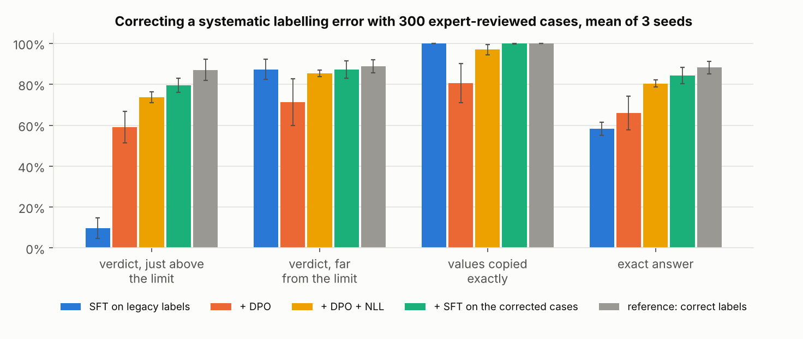
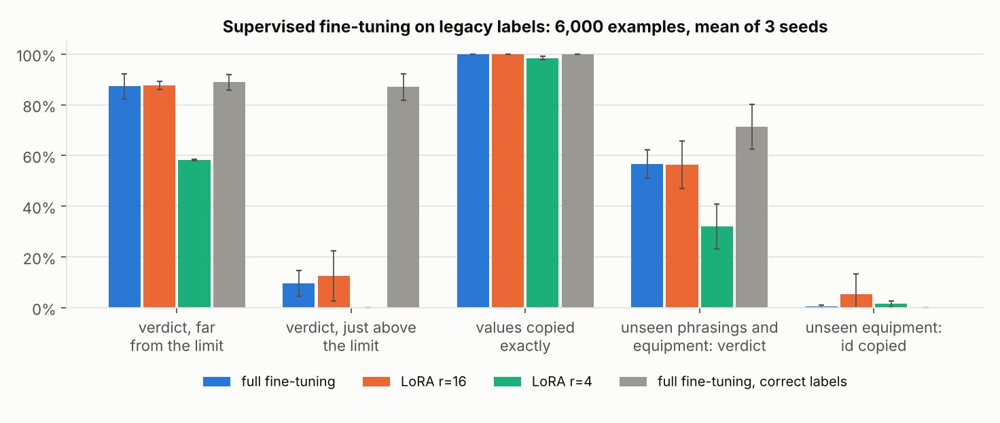
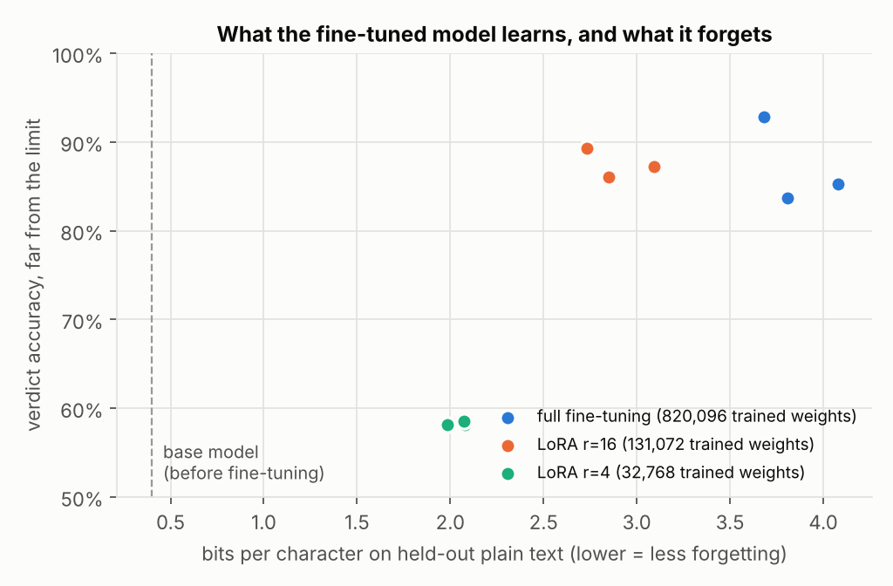
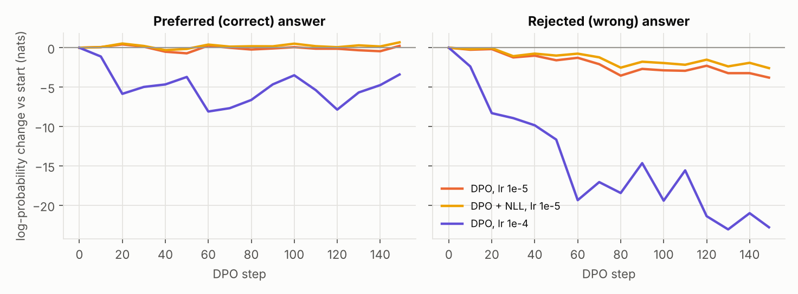

# finetune-lab

**What does fine-tuning teach a language model, what does it make it forget, and can preference optimisation repair
a systematic error in the training labels? A small GPT, LoRA and DPO written from scratch in PyTorch, measured on a
task where every answer can be checked exactly.**

  



## Why this setup

Fine-tuning results are easy to over-read: a judge model, a small test set or a single seed can turn noise into a
conclusion. Here the task is small enough to run 22 fine-tuning runs on a laptop CPU, and strict enough to grade every
answer with a parser:

```
Q: Pump P-12 temperature is 87 C, limit 80 C. Status?
A: ALARM P-12 87 C > 80 C
```

The model must copy the equipment id, the reading and the limit, and give the right verdict. Six phrasings, five
equipment types and four quantities (temperature, vibration, pressure, current) are used for fine-tuning. Two other
phrasings and two equipment types (conveyor, turbine) only appear in the out-of-distribution test set; they are present
in the pretraining text, so the base model has seen them.

**The labels have a realistic flaw.** They come from a legacy rule with a 3-unit dead band: a reading just above the
limit (81 C for 80 C) was labelled OK. That affects a quarter of the test set, the safety-relevant quarter.

| Component | What it is | Where |
|---|---|---|
| Data | Generator, exact grader, character tokenizer | [`ftlab/data.py`](ftlab/data.py) |
| Model | 4-layer GPT (0.82 M weights), LoRA adapter with exact merge | [`ftlab/model.py`](ftlab/model.py) |
| Training | Pretraining, SFT on answer tokens, DPO with optional NLL term, evaluation | [`ftlab/train.py`](ftlab/train.py) |
| Experiments | Every run, cached and seeded | [`run.py`](run.py), [`scripts/tune_fix.py`](scripts/tune_fix.py) |

## Protocol

1. **Pretraining** on 2.3 M characters of plain technical text (logs, shift reports, number comparisons), never in the
   question-answer format: 1,200 steps, 4 minutes on 2 CPU cores.
2. **Supervised fine-tuning** on 6,000 examples with the legacy labels, 1,000 steps, with full fine-tuning, LoRA rank 16
   and LoRA rank 4 (adapters on the attention and MLP projections). A reference run uses correct labels.
3. **Repair** with 300 cases reviewed by an expert, drawn like real traffic: DPO on (correct, wrong verdict) pairs,
   DPO with a negative log-likelihood term on the preferred answer, or plain SFT on the corrected answers. Settings are
   chosen on a separate dev set for the verdict just above the limit, the error being repaired ([`results/tuning_dev.txt`](results/tuning_dev.txt)), never on the test set.
4. **Measurement** on 400 in-distribution and 300 out-of-distribution test questions, greedy decoding, 3 seeds per
   setting. Bars show the mean and whiskers one standard deviation. Forgetting is measured in bits per character on
   held-out plain text.

## Results

### 1. Fine-tuning learns the format, the copy and the bug



| Setting (3 seeds) | Trained weights | Exact answer | Verdict far from the limit | Verdict just above the limit | Values copied | Forgetting (bits/char) |
|---|---:|---:|---:|---:|---:|---:|
| Base model | 0 | 0 % | 0 % | 0 % | 0 % | 0.40 |
| Full fine-tuning | 820,096 | 58 % | 87 % | **10 %** | 100 % | 3.86 |
| LoRA r=16 | 131,072 | 60 % | 88 % | 13 % | 100 % | 2.89 |
| LoRA r=4 | 32,768 | 36 % | 58 % | 0 % | 98 % | 2.05 |
| Full fine-tuning, correct labels | 820,096 | 88 % | 89 % | 87 % | 100 % | 4.12 |

* **The model reproduces the labelling error faithfully**: 10 % right just above the limit, against 87 % with correct
  labels. Fine-tuning does exactly what the data says, including what the data gets wrong.
* **LoRA r=16 matches full fine-tuning with 6 times fewer trained weights, and forgets less** (2.9 against 3.9 bits per
  character). **LoRA r=4 is too small for the comparison**: it learns the format and the copy, then answers OK every time.
* **Generalisation is the weak point**: on unseen equipment, no setting copies the new id prefix (CV-, T-), even though
  the base model saw it in pretraining. A model this small does not transfer copying to unseen tokens.



### 2. Repairing the error with 300 expert-reviewed cases

| Repair (3 seeds) | Exact answer | Just above the limit | Far from the limit | Values copied |
|---|---:|---:|---:|---:|
| none (SFT on legacy labels) | 58 % | 10 % | 87 % | 100 % |
| DPO | 66 % | 59 % | 71 % | **81 %** |
| DPO + NLL | 80 % | 74 % | 85 % | 97 % |
| SFT on the corrected cases | **84 %** | **79 %** | 87 % | 100 % |
| reference: correct labels everywhere | 88 % | 87 % | 89 % | 100 % |

* **With the same 300 cases, plain SFT on the corrected answers does best here.** The preference pairs carry no more
  information than the corrected answers, and the task has one right answer: this is not the setting where preference
  optimisation shines.
* **Plain DPO fixes the verdict but damages the copy**: one answer in five alters a value. DPO only constrains the gap
  between the two answers, not the likelihood of the preferred one.
* **Adding the negative log-likelihood of the preferred answer** (as in RPO) keeps the copy at 97 % and gains 14 points.



With a learning rate ten times higher, DPO pushes both answers down, the preferred one included, and the exact answer
rate falls to 20 %: the margin keeps growing while the model degrades. Watching the log-probability of the preferred
answer, not only the DPO loss, is what catches it.

## Run

```bash
pip install -r requirements.txt
pytest -q                      # 9 tests, about 20 s
python run.py                  # every experiment, about 50 min on 2 CPU cores, cached in .cache/
python scripts/tune_fix.py     # dev-set search for the repair settings
python run.py --figures        # redraw the figures from results/
```

## Limits

* The model has 0.82 M weights and a character vocabulary. The behaviours studied here (copying a label bias, the
  rank needed by LoRA, likelihood displacement in DPO) are known at scale, but the exact numbers are not transferable.
* The preference pairs are built from a rule, not from model samples: on-policy pairs (rejected answers generated by
  the model itself) would be the natural next experiment.
* Three seeds give a spread, not a confidence interval; differences of a few points between settings are not
  significant.

## License

MIT
